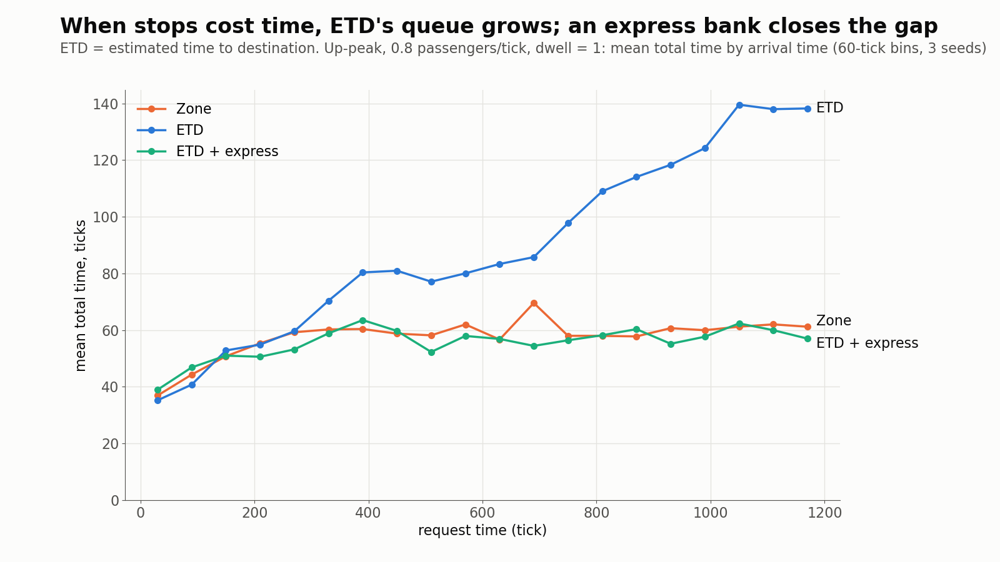
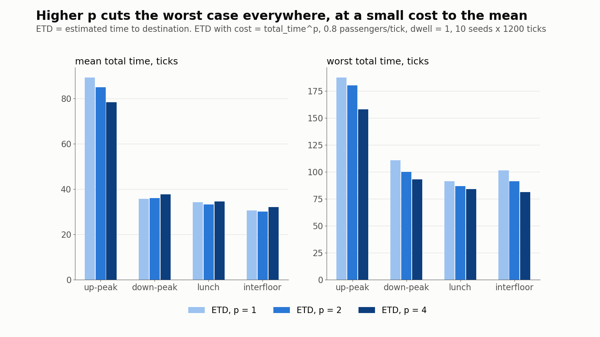

# Elevator simulation

A discrete-time simulation of a destination-dispatch elevator system. Each passenger is assigned to a car when they call, and the assignment never changes. Time moves one floor per tick, and the simulation only sees requests whose time has come.

The default scheduler is ETD (estimated time to destination). In my simulations it gives the lowest average trip time of the five dispatchers I tried in every traffic pattern, except a heavy morning rush where stops take time or the building is near capacity.

Python 3.10+, standard library only. Tests use pytest; the charts script uses matplotlib.

## Running it

```bash
python -m elevator_sim examples/spec_example.csv --floors 60 --cars 2
```

This prints a summary and writes `output/positions.csv` (each car's floor at every tick, from 0), `output/passengers.csv` and `output/summary.json`. The input is a CSV with the header `time,id,source,dest`, as in the brief.

Options: `--cars`, `--capacity`, `--dispatcher` (`etd`, `zone`, `nearest`, `directional`, `round-robin`), `--dwell` (extra ticks per stop, default 0), `--express 2,3:1,16-30` (cars 2 and 3 only stop at floor 1 and floors 16-30), `--start-floor`.

From Python:

```python
from elevator_sim import simulate

result = simulate([(0, "passenger1", 1, 51), (0, "passenger2", 1, 37), (10, "passenger3", 20, 1)],
                  floors=60, num_cars=2, capacity=10)
```

Other commands:

```bash
python -m pytest                    # tests
python -m elevator_sim.benchmark    # experiments -> results/ (about 5 min)
python -m elevator_sim.capacity     # building-size comparison -> results/ (about 30 min)
python scripts/charts.py            # charts -> docs/charts/
```

Besides min/mean/max wait and total time, the summary reports total time divided by the ideal (`|dest - source|`, which no scheduler can beat).

## Design

Two decisions: **dispatch** picks a car for each new passenger, once (`dispatch.py`); **routing** picks each car's direction, every tick (`routing.py`).

Each tick (`engine.py`): assign new requests → at each car, riders get off, the car picks a direction, and waiting passengers going that way get on → log positions → move. Only `feed.py` holds future requests, so nothing can look ahead.

**ETD.** For each car, simulate its future with and without the new passenger, using the engine's own per-car rules (`rules.py`). The difference is the newcomer's trip time plus the delay they add for everyone already assigned to that car. Pick the smallest. Each passenger costs `total_time²`, so one very long trip counts more than several short ones. On the brief's example, round robin makes passenger3 wait 71 ticks; ETD, 19.

**LOOK routing.** Keep going while there are pickups ahead, otherwise turn around. Riders aboard all share one direction, so they decide it.

**No one waits forever.** LOOK with a capacity limit can pass the same floor indefinitely if the car keeps filling up first (there's a test for this). After `max_wait` ticks (default 3 × floors), a car's oldest waiting passenger becomes its target and gets a reserved seat. Nobody is skipped forever, though under overload several overdue passengers queue behind each other.

## Results

Three findings:

1. **Below full load, ETD gives the fastest trips** in every traffic pattern and building size I tested.
2. **In a heavy morning rush, zoning carries more people.** ETD's per-passenger choices add stops. Express cars close the gap.
3. **The cost exponent trades average speed for worst-case speed**, which is the fairness/efficiency dial the brief asks about.

Setup: 30 floors, 4 cars, capacity 10; four office traffic patterns with random arrivals; 10 random days × 1200 ticks per setting, the same days for every dispatcher.

**1. ETD is fastest.** Mean total time in ticks at 0.8 passengers per tick, free stops:

| Scenario | Round robin | Nearest car | Nearest, direction-aware | Zone | ETD |
|---|---|---|---|---|---|
| Up-peak | 46.6 | 94.9 | 78.0 | 39.0 | **33.3** |
| Down-peak | 45.2 | 52.8 | 38.9 | 51.5 | **26.0** |
| Lunch | 41.5 | 39.9 | 29.2 | 35.2 | **23.6** |
| Interfloor | 35.4 | 31.3 | 22.3 | 41.3 | **18.4** |

ETD is 15-33% faster than the best alternative in each row. Direction-aware nearest car (a car only counts as close if it's already heading to the caller the right way) is the classic rule most systems start from.


The same holds in other buildings (10-60 floors, 2-8 cars). A fixed arrival rate can't be compared across buildings, so I first measured each building's *handling capacity*: the highest arrival rate before the number of people inside keeps growing. At half of that, ETD is fastest in all 24 cases, by 5-29%.

**2. The morning rush.** When stops cost a tick, ETD's queue keeps growing in up-peak (mean 85 ticks, against 58 for zoning). ETD puts each lobby passenger wherever is best for them right now, so every car gets a mix of destinations. An ETD car leaving the lobby stops at about 8 floors and climbs to floor 28; a zoned car stops at 4-5 and reaches floor 19. Longer round trips carry fewer people per minute.

Making cars 2-3 express to floors 16-30 brings ETD level with zoning (57), but costs 4-5 ticks at lunch. Across building sizes, zoning carries 3-28% more morning-rush traffic than ETD in all but one case. The mechanism is general; the load where it starts depends on my synthetic traffic.




**3. Fairness.** Each passenger costs `total_time^p`. With one-tick stops, going from p = 1 to p = 4 cuts the worst trip by 8-20% and raises the mean by up to 6%. I kept p = 2 as a middle ground.



Full tables are in `results/`.

## Assumptions

- Floors are 1 to n; floor 1 is the lobby. Cars start at floor 1.
- One tick is one floor. Stops are free by default, because the brief only defines travel time; `--dwell` adds time per stop, and every experiment is also run at dwell 1.
- In a tick a car drops off, picks a direction, boards, then moves. The log records the floor before the move.
- Passengers board only their assigned car, only when it's going their way, first come first served.
- Express cars only get trips where they serve both floors.
- Bad input (floor out of range, source = dest, duplicate id, negative time) is rejected up front.
- Synthetic traffic uses Poisson arrivals and trip mixes I chose (e.g. up-peak: 85% lobby to upper floors, 10% between upper floors, 5% down to the lobby). They are plausible, not measured.
- The main experiments use one building (30 floors, 4 cars, capacity 10); the building-size comparison covers 10-60 floors and 2-8 cars, all with capacity 10.
- A passenger becomes overdue after 3 × floors ticks, about one and a half round trips of an empty car. That threshold is a judgement call; it's configurable.

## Trade-offs

- **ETD** optimises the brief's objective (squared, to favour the worst trips), but it is greedy: it can't see future arrivals, which costs capacity near saturation.
- **LOOK** leaves little to choose once riders are aboard. A look-ahead router I tried gained 1-4% and nothing on top of ETD, so I removed it.
- **Forecasts reuse the engine's code**, so they can't drift from the real rules, at the cost of speed.
- **The reserved seat** costs one seat, only while someone is overdue. My first version, which let only the overdue passenger board, wrecked throughput.

## Limitations

- ETD slows down when one car has a long queue (each forecast replays it tick by tick).
- Idle cars stay where they stop; there is no parking.
- Constant speed, fixed door time, synthetic traffic: good for comparing dispatchers, not for absolute predictions.

## With more time

- Make ETD account for future arrivals, or switch to grouping by destination when the morning rush is detected.
- Park idle cars where requests have been coming from.
- Solve small cases exactly to measure how far ETD is from optimal.
- Cache forecasts within a tick and cap their length.
- Run real building logs through it.

## Time spent

About 8 hours.
