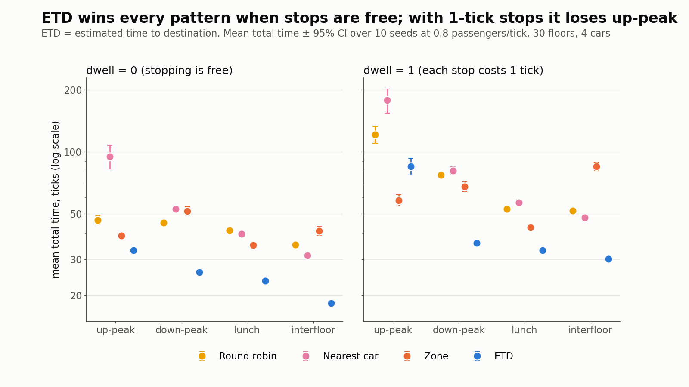
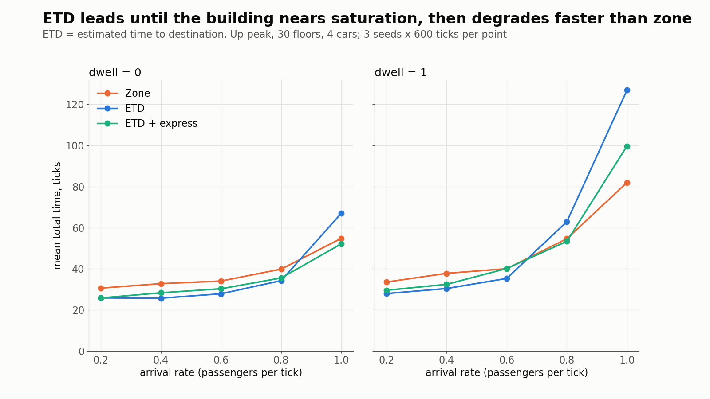

# Elevator simulation

A discrete-time simulation of a destination-dispatch elevator system. Passengers enter their destination when they call. The controller assigns each one to a car right away, and that assignment never changes. Time moves one floor per tick, and the simulation only sees requests whose time has come.

The default scheduler is ETD (estimated time to destination). Up to heavy load it gives the lowest average trip time of the four dispatchers I tried, in every traffic pattern. Near full capacity it falls behind zoning, because its choices add stops. Results below.

Python 3.10+, standard library only. Tests use pytest; the charts script uses matplotlib.

## Running it

```bash
python -m elevator_sim examples/spec_example.csv --floors 60 --cars 2
```

This prints a summary and writes `output/positions.csv` (each car's floor at every tick), `output/passengers.csv` and `output/summary.json`.

Options: `--cars`, `--capacity`, `--dispatcher` (`etd`, `zone`, `nearest`, `round-robin`, or `etd-p<k>`), `--dwell` (extra ticks per stop, default 0), `--express 2,3:1,16-30` (cars 2 and 3 only stop at floor 1 and floors 16-30), `--start-floor`.

The input CSV is `time,id,source,dest`. The header line is optional, so the rows from the brief can be used as they are.

From Python:

```python
from elevator_sim import simulate

result = simulate([(0, "passenger1", 1, 51), (0, "passenger2", 1, 37), (10, "passenger3", 20, 1)],
                  floors=60, num_cars=2, capacity=10)
result.positions[t]     # floor of each car at tick t, starting at 0
result.passengers       # each has wait_time, travel_time, total_time
```

Other commands:

```bash
python -m pytest                                  # tests
python -m elevator_sim.benchmark                  # all experiments -> results/ (about 5 min)
python scripts/charts.py                          # charts -> docs/charts/
python -m elevator_sim.scenarios lunch --floors 30 --rate 0.4 --out traffic.csv
```

### Output

`positions.csv`:

```
time,car_0,car_1
0,1,1
1,2,1
...
```

Summary for the brief's example:

```
3 passengers, finished at t=50
             min    mean     p50     p95     max
    wait     0.0     6.3     0.0    19.0    19.0
  travel    19.0    35.0    36.0    50.0    50.0
   total    36.0    41.3    38.0    50.0    50.0
total time / ideal time: 1.18  (1.00 = nobody waited and every ride was direct)
drift: last third of passengers took -12.0 ticks vs the first third
passengers per car: {0: 2, 1: 1}
slowest: passenger1 (total 50, of which waiting 0)
```

The "ideal" time for a passenger is `|dest - source|`, which no scheduler can beat. Drift compares the last third of passengers with the first third. If it is large and positive, the queue is growing and the building can't keep up with that arrival rate.

## Design

There are two decisions, and the brief constrains them differently:

- **Dispatch** (`dispatch.py`): which car takes a new passenger. Made once, at request time.
- **Routing** (`routing.py`): which way each car moves. Made every tick.

Each tick (`engine.py`) does four things in order:

1. **Assign** new requests.
2. **Service** each car: riders get off, the car picks a direction, and waiting passengers going that way get on, up to capacity.
3. **Log** positions.
4. **Move** each car one floor.

`feed.py` is the only object that holds future requests. Schedulers never see it, so they can't look ahead; a test checks this.

**Dispatch: ETD.** For each car, simulate its future with and without the new passenger. The difference is the new passenger's own trip time plus the delay they cause everyone already assigned to that car. Pick the car with the smallest difference. The forecast reuses the engine's own per-car code (`rules.py`), so it follows exactly the same rules as the real run.

Each passenger's cost is `total_time²` rather than `total_time`, so one very long trip weighs more than several short ones. In the brief's example, round robin gives passenger3 a 71-tick wait; ETD gives 19.

**Routing: LOOK.**
- With riders aboard, keep their direction. Riders only board a car going their way, so they all share one direction.
- With no riders, keep going while there are pickups ahead, and turn around when there aren't.
- A car that was idle heads to the nearest waiting passenger.

**Nobody waits forever.** LOOK plus a capacity limit can starve someone: if a car keeps filling up before it reaches floor 5, the person at floor 5 can wait without limit (there's a test for this). So:
1. A passenger who has waited `max_wait` ticks (default 3 × floors) becomes overdue.
2. Their car heads for them and keeps one seat free.
3. Once they are first in their car's line, they are picked up within about three sweeps of the building.

There's a test for that too. It is not a hard bound on every wait: overdue passengers on one car are served oldest first, so if several pile up, each waits for the ones ahead. When arrivals outpace what the cars can carry, waits grow without limit under any rule. The guard only guarantees that nobody is skipped forever.

Code layout:

| File | Contents |
|---|---|
| `models.py` | Request, Passenger, Car |
| `feed.py` | Releases requests as their time comes |
| `routing.py` | LOOK |
| `rules.py` | What one car does in one tick; forecasting |
| `dispatch.py` | ETD, round robin, nearest car, zone |
| `engine.py` | Config, the simulation loop, `simulate()` |
| `metrics.py`, `csv_io.py`, `__main__.py` | Stats, CSV, command line |
| `scenarios.py`, `benchmark.py` | Traffic generators and experiments |

## Results

**Setup.**
- Building: 30 floors, 4 cars, capacity 10.
- Traffic: four office patterns (morning up-peak, evening down-peak, lunch, interfloor). Random arrivals at 0.4 and 0.8 passengers per tick; up-peak saturates near 1.0.
- Runs: 10 seeds of 1200 ticks each. All dispatchers see the same requests.
- Full tables are in `results/`.

**Free stops (dwell 0)**, 0.8 passengers per tick, mean total time in ticks:

| Scenario | Round robin | Nearest car | Zone | ETD |
|---|---|---|---|---|
| Up-peak | 46.6 | 94.9 | 39.0 | **33.3** |
| Down-peak | 45.2 | 52.8 | 51.5 | **26.0** |
| Lunch | 41.5 | 39.9 | 35.2 | **23.6** |
| Interfloor | 35.4 | 31.3 | 41.3 | **18.4** |

- ETD is 15-42% faster than the best alternative in each row.
- It is 1.6-2.3 times the ideal time, and its drift stays under 3 ticks, so it keeps up.
- Its worst trips are also the shortest: 55-78 ticks, against 77-340 for the others.



**When a stop costs one tick (dwell 1)**, ETD can't keep up with the morning rush:

| Up-peak, 0.8/tick, dwell 1 | Mean total | Drift | Max |
|---|---|---|---|
| Zone | 58.1 | +15 | 225 |
| ETD | 84.9 | +67 | 180 |
| ETD, with cars 2-3 express to floors 16-30 | 56.7 | +13 | 126 |

**Why ETD falls behind:**
- ETD assigns each lobby passenger to whichever car is best at that moment, so every car ends up stopping at many floors.
- When stops cost time, those stops lower how many people the cars can move per minute, and the queue grows.
- Zoning keeps each car to a band of floors, so it makes fewer stops.
- Express cars get the same effect for the upper floors, and ETD handles the rest.

In the other three patterns at dwell 1, ETD is still 23-47% faster than the next best.


The same thing happens with free stops, just later. Sweeping the up-peak arrival rate, ETD leads up to 0.8 per tick. At 1.0 it is behind both alternatives: ETD 67, zone 55, ETD with express 52. These figures are from the chart script, 3 seeds × 600 ticks. With one-tick stops at 1.0, zone (82) also beats ETD with express (100).



I tried three changes to ETD to fix this:
- a penalty for keeping a car busy longer;
- a penalty for adding a new stop;
- a hybrid that zones lobby trips during the morning rush.

None helped without making something else worse.

**Fairness.** The cost exponent p (cost = total_timeᵖ) trades average time for worst case. At dwell 1, going from p = 1 to p = 4 lowers the longest trip in every pattern: up-peak 188 → 158, down-peak 111 → 93, interfloor 101 → 81. The mean barely moves, except in the overloaded morning rush, where it also improves (89 → 78). At dwell 0 the differences are within noise. I left p = 2 as the default.

Zoning and express cars are the other trade-off: they give up flexibility to carry the main flow faster. Zoning on top of the express setup does badly (up-peak dwell 1: mean 209).


**Other observations:**
- Lunch at 0.8 per tick, median and 95th-percentile wait: ETD 7 / 22 ticks, zone 17 / 49, nearest car 21 / 56, round robin 27 / 52.
- With interfloor traffic, waits are nearly the same on every floor. The top two and bottom two floors wait about 1.5 ticks longer.
- `docs/charts/space_time.png` plots each car's floor over time.

## Assumptions

- **Floors** are numbered 1 to n. Floor 1 is the lobby; it matters only to the zone dispatcher and the traffic generator. All cars start at floor 1 unless `--start-floor` says otherwise.
- **Time:** one tick is one floor of travel. There's no acceleration.
- **Stops are free by default.** The brief only says one time unit equals one floor. `--dwell` adds time per stop, and every experiment is also run with `dwell = 1`.
- **Order within a tick:** a car drops off, picks a direction, boards, then moves. A passenger whose car is already at their floor waits 0. The log records each car's floor before it moves.
- **Definitions:** wait is request to boarding; travel is boarding to drop-off; total is wait plus travel.
- **Boarding:** passengers board only their assigned car, only when it's going their way, and first come first served. Anyone who doesn't fit waits for the car's next pass.
- **Express cars** only stop at their listed floors. A trip is only offered to cars that serve both of its floors; a trip no car can serve is rejected.
- **Input** is checked up front: floors in range, source ≠ dest, unique ids, time ≥ 0. Requests in the same tick are assigned in file order, and the file doesn't need to be sorted.
- **Synthetic traffic** uses Poisson arrivals and fixed trip mixes. For example, up-peak is 85% lobby to upper floors, 10% between upper floors, and 5% down to the lobby.

## Trade-offs

- **ETD over simpler rules.** It optimises the brief's objective directly. The cost is a forecast per car for every request, and it is greedy: no look-ahead, so it loses capacity near saturation.
- **LOOK for routing.** Once riders are aboard, the direction rule leaves no choice anyway. I also tried a router that simulated both directions whenever a car was empty. It was never worse than LOOK, but it only gained 1-4% and nothing at all on top of ETD, so I removed it.
- **p = 2.** It costs nothing when the building is keeping up, and helps the worst cases when it isn't.
- **Reserved seat for overdue passengers.** It costs at most one seat, and only while someone is overdue. My first version let only the overdue passenger board, which wrecked throughput under heavy load.
- **Forecasts reuse the engine's code.** Predictions can't drift from what the simulation does. The price is speed: they re-simulate tick by tick.

## Limitations

- **ETD is greedy.** It can't see future arrivals, assignments are final, and near saturation it adds stops that cost throughput.
- **ETD gets slow with long queues.** Each request costs about cars × forecast length × passengers per car. That's fine at these sizes, but it grows quickly when one car has a long queue.
- **Idle cars stay where they stop.** There's no parking strategy.
- **Simple physics:** constant speed and a fixed door time.
- **Synthetic traffic only.** The numbers are useful for comparing dispatchers, not as absolute predictions.
- **The ideal-time bound is loose.** It shows the gap, not how close each run is to the true optimum.

## With more time

- Make ETD account for future passengers, using the arrival rate seen so far, or switch to destination grouping when the morning rush is detected.
- Park idle cars where requests have been coming from.
- Solve small cases exactly (e.g. as an integer program) to measure how far ETD is from optimal.
- Cache each car's forecast within a tick and cap the forecast length.
- Run real building logs through it, converting ticks to seconds.

## Time spent

About 8 hours.
