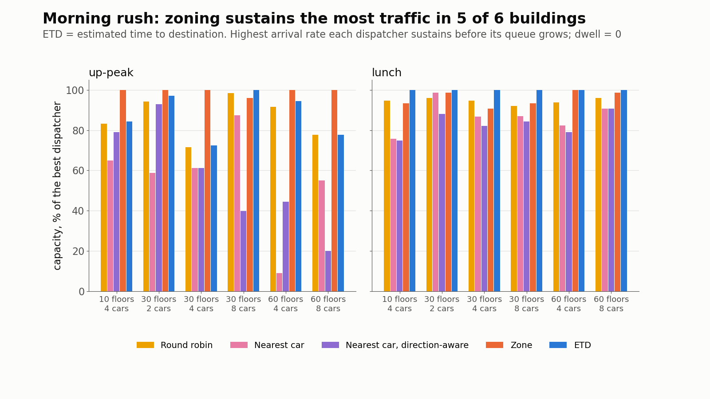

# Elevator simulation

A discrete-time simulation of a destination-dispatch elevator system. Each passenger is assigned a car the moment they call, permanently. The clock advances one floor per tick, and the controller only sees requests whose time has come.

**Approach:** each new passenger gets the car that adds the least total trip time (ETD, estimated time to destination). Cars sweep with LOOK, and a guard ensures nobody waits forever.

Python 3.10+, standard library only. Tests use pytest; charts use matplotlib.

Slides for the walkthrough: [`docs/presentation.pdf`](docs/presentation.pdf).

## Running it

```bash
python -m elevator_sim examples/spec_example.csv --floors 60 --cars 2
```

The input is a CSV with the header `time,id,source,dest`, as in the brief. The run prints min/mean/max wait and total time, plus total ÷ ideal time (`|dest - source|`, which nothing can beat). It writes:
- `output/positions.csv`: every car's floor at every tick, from 0;
- `output/passengers.csv`;
- `output/summary.json`.

| Option | Meaning |
|---|---|
| `--floors`, `--cars`, `--capacity` | Building size; capacity is passengers per car |
| `--dispatcher` | `etd` (default), `zone`, `nearest`, `directional`, `round-robin` |
| `--dwell` | Extra ticks per stop (default 0) |
| `--express 2,3:1,16-30` | Cars 2 and 3 stop only at floor 1 and floors 16-30 |
| `--start-floor` | Where cars begin |

From Python:

```python
from elevator_sim import simulate

result = simulate([(0, "passenger1", 1, 51), (0, "passenger2", 1, 37), (10, "passenger3", 20, 1)],
                  floors=60, num_cars=2, capacity=10)
```

Other commands:

```bash
python -m pytest                    # tests
python -m elevator_sim.benchmark    # experiments -> results/ (about 5 min)
python -m elevator_sim.capacity     # building-size comparison -> results/ (about 30 min)
python scripts/charts.py            # charts -> docs/charts/
```

## Design

There are two decisions:
- **dispatch** picks a passenger's car once, at request time (`dispatch.py`);
- **routing** picks each car's direction every tick (`routing.py`).

Each tick (`engine.py`): assign new requests → at each car, riders get off, the car picks a direction, and passengers waiting there and going that way board, up to capacity → log positions → move. Only `feed.py` holds future requests, so nothing can look ahead.

**ETD.** For each car, simulate its future with and without the newcomer, using the engine's own per-car rules (`rules.py`). The difference is the newcomer's trip plus the delay they add for everyone already on that car. Pick the smallest. Each passenger costs `total_time^p` (default p = 2), so one long trip counts more than several short ones.

**LOOK** (the classic elevator sweep). Keep going while there are pickups ahead, otherwise turn around. Passengers only board a car going their way, so once anyone is aboard, the direction is fixed.

**Nobody waits forever.** LOOK with a capacity limit can pass a floor indefinitely if the car keeps filling up first (a test shows this). After 3 × floors ticks, a car's oldest waiting passenger becomes its target and gets a reserved seat. Nobody is skipped forever, though under overload several overdue passengers queue behind each other.

## Results

1. **Below full load, ETD is fastest** in every traffic pattern and building size tested.
2. **In a heavy morning rush, zoning carries more people;** express cars close the gap.
3. **The cost exponent p trades average speed for worst-case speed:** the fairness/efficiency dial the brief asks about.

**Setup:**
- Building: 30 floors, 4 cars, capacity 10.
- Runs: 10 random days × 1200 ticks per setting, the same days for every dispatcher.
- Traffic: four office patterns with random arrivals:
  - up-peak (mostly lobby → up);
  - down-peak (mostly → lobby);
  - lunch (both ways);
  - interfloor (between upper floors).
- Stops: "free stops" is dwell 0; "one-tick stops" is dwell 1.

Full tables are in `results/`.

### 1. ETD is fastest

Mean total time in ticks, 0.8 passengers per tick, free stops:

| Scenario | Round robin | Nearest car | Nearest, direction-aware | Zone | ETD |
|---|---|---|---|---|---|
| Up-peak | 46.6 | 94.9 | 78.0 | 39.0 | **33.3** |
| Down-peak | 45.2 | 52.8 | 38.9 | 51.5 | **26.0** |
| Lunch | 41.5 | 39.9 | 29.2 | 35.2 | **23.6** |
| Interfloor | 35.4 | 31.3 | 22.3 | 41.3 | **18.4** |

ETD beats the best alternative in each row by 15-33%. Direction-aware nearest car, where a car counts as close only if it's already heading to the caller the right way, is the classic rule.


The brief's three-passenger example can't separate the better dispatchers. Round robin and plain nearest car make passenger3 wait 71 ticks; ETD, direction-aware nearest car and zoning all give 19.

**Other buildings** (10-60 floors, 2-8 cars):
- Fixed arrival rates aren't comparable across buildings. So I measured each building's *handling capacity*: the highest arrival rate before the number of people inside keeps growing.
- At half capacity, ETD is fastest in all 24 cases (6 buildings × up-peak and lunch × free and one-tick stops), by 5-29%.
- Two 2-car cases, where there's little choice to make, are within the confidence interval.

### 2. The morning rush

In up-peak, ETD's queue starts growing at a lower arrival rate than zoning's: 0.88 vs 1.21 passengers per tick, with free stops. One-tick stops lower that point further. At 0.8 per tick ETD is then overloaded: mean 85 ticks vs 58 for zoning.

**Why:** ETD sends each lobby passenger to whichever car suits them, so every car gets a mix of destinations. An ETD car leaving the lobby stops at about 8 floors and climbs to floor 28; a zoned car stops at 4-5 and stays below 20. Longer round trips carry fewer people per minute.

**What helps:**
- Making cars 2-3 express to floors 16-30 brings ETD level with zoning (57), at a cost of 4-5 ticks at lunch.
- Across building sizes, ETD's morning-rush capacity is 3-28% below zoning's in all but one case.

The mechanism is general; the load where it starts depends on my synthetic traffic.




### 3. Fairness

With one-tick stops, raising p from 1 to 4 cuts the worst trip by 8-20% and raises the mean by up to 6%. With free stops, p barely matters. I kept p = 2.


## Recommendation

Use ETD by default and switch to zoning or an express bank for the morning rush. Calibrate first with the building's own lobby logs: arrival patterns, door times and travel speed.

## Assumptions and simplifications

- **Building:** "car" means one elevator. Floors run 1 to n, with floor 1 the lobby. Cars start there.
- **Time:** wait is request → boarding; travel is boarding → drop-off; total is wait + travel, as in the brief.
- **Stops:** one tick per floor. Stops are free by default, since the brief only defines travel time; `--dwell` adds stop time, and every experiment is also run at dwell 1.
- **Log:** records each car's floor before that tick's move.
- **Boarding:** only your assigned car, only when it's going your way, first come first served.
- **Express cars** skip floors but move at normal speed, and only get trips where they serve both floors.
- **Validation:** bad input (floor out of range, source = dest, duplicate id, negative time) is rejected up front.
- **Traffic:** synthetic Poisson arrivals with trip mixes I chose (e.g. up-peak: 85% lobby → up, 10% between floors, 5% down). Plausible, not measured.
- **Buildings tested:** one main building; the size comparison covers 10-60 floors and 2-8 cars, all capacity 10.
- **Overdue threshold:** 3 × floors, about one and a half empty round trips. A judgement call, and configurable.

## Trade-offs

- **ETD** optimises the brief's objective (squared, to favour the worst trips) but is greedy. It can't see future arrivals, which costs capacity near saturation.
- **LOOK** leaves little to choose once riders are aboard. A look-ahead router I tried gained 1-4%, and nothing on top of ETD, so I removed it.
- **Forecasts reuse the engine's code,** so they can't drift from the real rules, at the cost of speed.
- **The reserved seat** costs one seat, and only while someone is overdue. My first version, which let only the overdue passenger board, wrecked throughput.

## Limitations

- ETD slows down when a car has a long queue, because each forecast replays it tick by tick.
- No parking: idle cars stay where they stop.
- Constant speed, fixed door time and synthetic traffic: fine for comparing dispatchers, not for absolute predictions.

## With more time

In order, each building on the last:

1. **Calibrate with real data.** Destination-dispatch kiosks log every call. Convert a building's logs to `time,id,source,dest`, set ticks to seconds and real door times, and replay them against its current controller.
2. **Fix the known weakness simply.** Detect the morning rush from the lobby arrival rate and switch to zoning or an express bank.
3. **Tune per building.** Search p, zone boundaries and the switch threshold on the replayed logs.
4. **Try a learned policy only if a gap remains.** Reinforcement-learning dispatchers have beaten heuristics in simulation (Crites and Barto, 1995; recent deep-RL work), and this simulator is where one would be trained. They're harder to explain, though, and need hard limits so nobody is starved.
5. **Engineering.** Cache forecasts within a tick, park idle cars near demand, and solve small cases exactly to measure ETD's distance from optimal.

## Time spent

About 8 hours.
